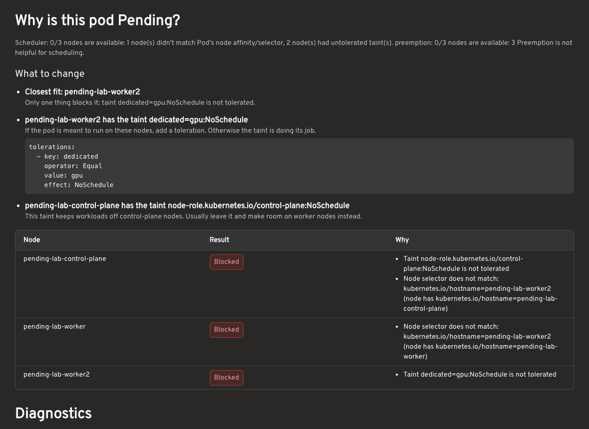
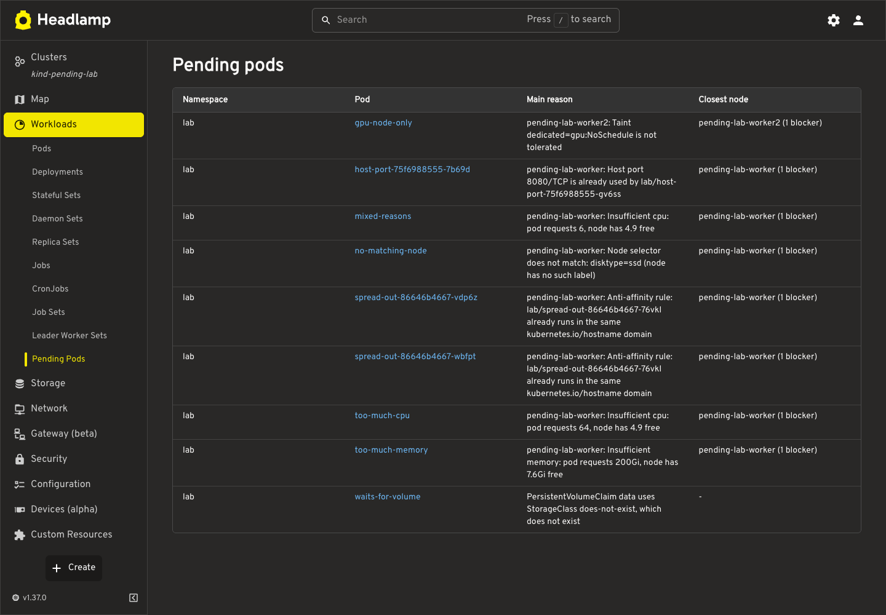

# Pending Explainer for Headlamp

A [Headlamp](https://headlamp.dev) plugin that explains why a Kubernetes pod is stuck in `Pending`: which nodes rejected it, why each one did, and what to change.



## Why

When a pod cannot be scheduled, the scheduler leaves a message like this:

```
0/3 nodes are available: 1 node(s) didn't match Pod's node affinity/selector,
2 node(s) had untolerated taint(s). preemption: 0/3 nodes are available:
3 Preemption is not helpful for scheduling.
```

It only gives counts. It does not say which nodes, which taint, how much CPU is missing, or which pod holds the port. Recent Kubernetes versions no longer include the taint in the message at all, and Headlamp's Diagnostics panel shows the message as it is.

This plugin works it out from the cluster's own state and shows, on the pod's page:

- **What to change**: the closest node and the one thing blocking it, a ready-to-paste toleration, the label no node has, how far the CPU or memory request is from the most free on any node, the pod already holding a host port, or the StorageClass that does not exist.
- **Every node**: whether it fits and every reason it does not, not only the first one the scheduler stopped at. A node that needs both a toleration and more CPU says so.

It also adds a **Pending Pods** page under Workloads listing every unscheduled pod in the cluster, its main reason and its closest node.



## What it checks

The checks follow the scheduler's default filter plugins, in the same order:

| Scheduler plugin | What the plugin reports |
|---|---|
| NodeUnschedulable | Cordoned nodes, with the `kubectl uncordon` command |
| TaintToleration | The exact taint on each node, and the toleration that would match it. The control-plane taint is flagged as one to leave alone |
| NodeAffinity | Which `nodeSelector` labels a node is missing or has with another value, and required node affinity expressions (`In`, `NotIn`, `Exists`, `DoesNotExist`, `Gt`, `Lt`, `matchFields`) |
| NodePorts | The pod that already uses the host port on that node |
| NodeResourcesFit | Requested against free CPU, memory, ephemeral storage, extended resources such as GPUs, and the node's pod limit. Init containers and pod overhead are counted the way the scheduler counts them |
| VolumeBinding | Claims that do not exist, claims whose StorageClass does not exist (with the classes that do), and unbound claims |
| InterPodAffinity | Required pod affinity, required anti-affinity in both directions, and the pod that causes the conflict |

Reasons it does not model yet, such as topology spread constraints and volume zone conflicts, are passed through from the scheduler's message with advice.

## Checked against the real scheduler

The analysis is compared with the scheduler's own counts on every pod. If they disagree, for example because the cluster changed since the scheduler last tried, the section says so instead of guessing.

The tests run against a snapshot of a real [kind](https://kind.sigs.k8s.io) cluster on Kubernetes v1.37 with nine pods that cannot be scheduled for different reasons. For all nine, the per-node analysis matches the scheduler's counts exactly. Applying the suggested toleration to the `gpu-node-only` pod got it scheduled on the node the plugin named.

To reproduce it:

```
./lab/setup.sh
./lab/capture.sh
npm test
```

`lab/setup.sh` creates the cluster and the pods, and `lab/capture.sh` saves the cluster state into `src/__fixtures__`.

## Install

Build it and copy it into Headlamp's plugin folder:

```
npm install
npm run build
mkdir -p "<plugins folder>/headlamp-pending-explainer"
cp dist/main.js package.json "<plugins folder>/headlamp-pending-explainer/"
```

The plugins folder is `~/Library/Application Support/Headlamp/plugins` on macOS, `~/.config/Headlamp/plugins` on Linux and `%APPDATA%\Headlamp\plugins` on Windows. Restart Headlamp after copying.

For in-cluster Headlamp, use `npm run package` to build a tarball and follow Headlamp's [plugin deployment guide](https://headlamp.dev/docs/latest/installation/in-cluster/#plugins).

## Develop

```
npm install
npm start
npm test
npm run lint
npm run tsc
```

`npm start` rebuilds on change and loads the plugin into a running Headlamp desktop app.

The analysis in `src/analyze.ts` and `src/parse.ts` is plain TypeScript working on Kubernetes JSON, with no Headlamp or React imports, so it can be tested on its own. The UI is in `src/components`.

## Limits

- The plugin sees what the Headlamp user can list. Without permission to list nodes and pods across the cluster, the per-node view is incomplete.
- Custom scheduler profiles, scheduler extenders, Dynamic Resource Allocation, `namespaceSelector` in pod affinity, and topology spread constraints are not modelled.
- The resource check uses requests of pods already bound to each node. Pods the scheduler has nominated for preemption are not taken into account.

## License

Apache 2.0
